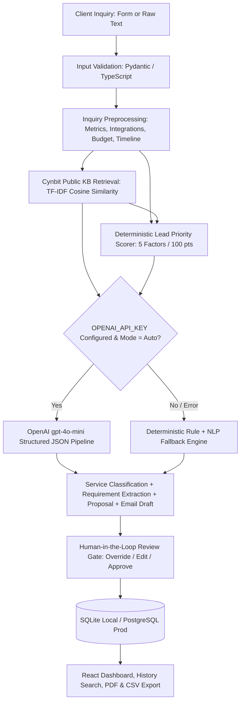

# Technical Approach Report — Cynbit Client Inquiry Intelligence

**Project:** AI-Powered Client Inquiry Intelligence & Automation Agent  
**Target Organization:** Cynbit Technologies (`https://www.cynbit.in/`)  

---

## 1. Project Overview

The **Cynbit Client Inquiry Intelligence Workbench** is an end-to-end full-stack AI/ML application engineered to ingest inbound client inquiries, retrieve relevant Cynbit services and proprietary SaaS offerings, compute transparent deterministic lead priority scores, extract technical requirements, generate preliminary project proposals, and draft human-approved client email responses.

The repository includes:
- A **live full-stack runtime** (`server.ts` + `src/`) running seamlessly on port 3000 with Express, TypeScript, React, Tailwind CSS, and Node's built-in SQLite (`node:sqlite`) for immediate browser and API evaluation.
- A **production Python FastAPI backend** (`backend/`) using FastAPI, Pydantic v2, SQLAlchemy ORM, OpenAI SDK, and SQLite/PostgreSQL portability for dedicated Python cloud deployment (Render/Docker).

---

## 2. Technical Objectives

1. **Deterministic + Probabilistic Hybrid Design:** Delegate semantic synthesis (requirement extraction, architecture summaries, tailored email prose) to an LLM (`gpt-4o-mini` with deterministic fallback), while keeping business-critical lead scoring (`0–100`) and input validation **100% deterministic and auditable**.
2. **Zero-Key Operability & Honesty:** Run reliably without an `OPENAI_API_KEY` via a TF-IDF + Rule-Based Deterministic Fallback Engine, explicitly tagging every record with its true `processing_mode` (`openai_llm` vs. `deterministic_fallback`).
3. **Human-in-the-Loop Governance:** Require explicit human review before any client email is marked approved, and allow human overrides on AI service classification and priority labels.
4. **PostgreSQL Migration Readiness:** Structure relational tables (`inquiries`, `inquiry_analyses`, `proposals`, `email_drafts`, `app_settings`) with standard SQLAlchemy ORM models compatible with both SQLite and PostgreSQL.

---

## 3. Architecture Diagram

---

## 4. Technology Stack and Justification

| Layer | Selected Technology | Engineering Justification |
| :--- | :--- | :--- |
| **Frontend** | React 19, TypeScript, Vite, Tailwind CSS v4 | Strict static typing, modular component architecture, crisp enterprise UI density, and fast static builds suitable for Vercel. |
| **PDF Export** | `jsPDF` | Pure client-side generation of multi-section downloadable PDF proposals without headless browser dependencies. |
| **Production Python API** | FastAPI, Pydantic v2, Uvicorn | Async-ready Python framework with automatic OpenAPI/Swagger docs (`/docs`) and strict schema validation. |
| **Live Sandbox Runtime** | Express + `tsx` + `node:sqlite` | Serves API and Vite SPA together on port 3000 in Node.js environments where Python pip wheels are restricted. |
| **ORM & Database** | SQLAlchemy 2.0 + SQLite (local) / PostgreSQL (prod) | Zero-setup local SQLite demonstration with one-line `DATABASE_URL` swap to managed PostgreSQL. |
| **AI & Retrieval** | OpenAI `gpt-4o-mini` + Custom TF-IDF Cosine Retriever | Low latency, cost-efficient structured JSON output paired with zero-dependency deterministic local vector retrieval. |

---

## 5. Model Selection and Justification

- **Primary LLM — OpenAI `gpt-4o-mini`:**
  - *Why:* Supports native `response_format={"type": "json_object"}` for reliable schema adherence, delivers strong reasoning on multi-paragraph B2B requirements, and maintains low token cost and sub-2-second latency for real-time intake forms.
  - *Temperature:* Fixed at `0.2` to minimize creative drift and keep technical recommendations grounded in retrieved Cynbit KB context.
- **Knowledge Retrieval — Custom TF-IDF + Cosine Similarity:**
  - *Why:* Over a curated catalog of Cynbit's 9 public service lines and SaaS products, TF-IDF cosine similarity executes in <2ms locally, requires zero external embedding API calls, works completely offline in fallback mode, and produces inspectable `matched_terms` for explainability. (See Section 18 for `pgvector` upgrade path.)

---

## 6. Data Ingestion and Preprocessing

Every incoming inquiry passes through `preprocessor.ts` / `inquiry_processor.py`:
1. **Validation:** Enforces valid email format, minimum name/company length, and minimum 20-character project description (`400`/`422` error on failure).
2. **Raw Text Parsing (`/api/inquiries/quick-parse`):** Regex + heuristic extraction of email address, sender name, company domain, dollar budget signals, timeline urgency phrases, and industry vertical when unstructured email text is pasted.
3. **Entity Extraction:** Identifies named technical targets (`HubSpot`, `Razorpay`, `AWS`, `WhatsApp`, `ERP`, `Docker`, `PostgreSQL`, etc.), quantified operational metrics (`600 calls`, `1,200 units`, `300+ invoices`), corporate vs. free email domains, and normalized budget/timeline estimates.

---

## 7. Knowledge-Base Construction

The knowledge base (`sample_data/cynbit_knowledge_base.json`) contains **9 verified public entries** grounded strictly in `cynbit.in`:
1. AI Automation & Autonomous LLM Agents
2. Conversational AI Voice Agents
3. Full-Stack Web & SaaS Product Engineering
4. CRM Automation & Revenue Funnel Engineering
5. Cloud Infrastructure & Scalable Architecture
6. Technical SEO & Performance Digital Marketing
7. Revio — AI Review & Reputation Intelligence Assistant
8. TenantEase — Smart Property & Tenant Operations SaaS
9. Cynbit Studio & BitElevate Talent Ecosystem

Each entry stores `id`, `title`, `service_category`, `offering_type`, `source_url`, `summary`, `capabilities`, `typical_stack`, and `ideal_for`. Title tokens receive double term-frequency weighting during TF-IDF indexing.

---

## 8. Prompt Engineering Strategy

When `OPENAI_API_KEY` is active:
- **Grounding Guardrail:** The system prompt instructs the model to act as a Cynbit Principal AI Solutions Architect and **strictly forbid** inventing private client metrics or non-public company guarantees.
- **Context Injection:** Top-3 retrieved KB entries (with similarity scores and summaries) plus the pre-computed deterministic lead score are injected directly into the user prompt.
- **Structured Output:** `response_format: { type: "json_object" }` enforces keys for `service_category`, `confidence_score`, `client_problem`, `business_objectives`, `expected_features`, `technical_requirements`, `solution_architecture`, `proposal`, and `email_draft`.
- **Mandatory Disclaimer Injection:** The backend programmatically attaches the preliminary estimate disclaimer regardless of LLM output so commercial caveats can never be omitted by prompt variance.

---

## 9. Lead Scoring Methodology

Lead priority is computed **100% deterministically** on a transparent **0–100 point scale** across five auditable factors:

| Factor | Max Points | Scoring Logic |
| :--- | :---: | :--- |
| **Budget Alignment** | 25 | `>= $20k` → 25; `$10k–$19.9k` → 20; `$5k–$9.9k` → 14; `< $5k` → 8; Undisclosed → 6 |
| **Timeline & Urgency** | 25 | `<= 4 weeks` or explicit urgency keywords → 21–25; `5–10 weeks` → 17; `11–16 weeks` → 11; Exploratory → 6 |
| **Requirement Clarity** | 20 | Base (4) + word count depth (2–6) + named integrations (3–5) + quantified scale metrics (5) |
| **Cynbit Capability Fit** | 20 | Top KB cosine similarity: `>= 0.35` → 20; `>= 0.22` → 16; `>= 0.12` → 12; else → 8 |
| **Contact & Org Profile** | 10 | Base (4) + corporate email domain (+3) + complete company & industry (+3) |

**Thresholds (Configurable in Workspace Settings):**
- **High Priority:** `>= 70` points
- **Medium Priority:** `40 – 69` points
- **Low Priority:** `< 40` points

---

## 10. AI Pipeline

The 12-stage modular pipeline executes sequentially:
1. Input Validation → 2. Preprocessing & Entity Extraction → 3. Cynbit Knowledge Retrieval (TF-IDF) → 4. Deterministic Lead Priority Scoring → 5. Service Classification (LLM or Rule Engine) → 6. Requirement & Feature Extraction → 7. Solution Architecture Recommendation → 8. Preliminary Proposal Generation → 9. Personalized Email Draft → 10. Human Review Gate Initialization (`pending_review`) → 11. Atomic Database Persistence → 12. Dashboard Aggregation & PDF/CSV Export.

---

## 11. API Design

| Method | Endpoint | Purpose |
| :--- | :--- | :--- |
| `GET` | `/api/health` | Runtime health check and active AI mode indicator |
| `GET` | `/api/dashboard/metrics` | Aggregated KPIs, priority counts, category distribution, recent records |
| `GET` | `/api/inquiries` | Search (`q`) and filter (`priority`, `category`, `approval`) inquiry history |
| `POST` | `/api/inquiries` | Validate and execute 12-stage pipeline on structured inquiry |
| `POST` | `/api/inquiries/quick-parse` | Extract fields from raw text/email and run pipeline |
| `GET` | `/api/inquiries/:id` | Retrieve full inquiry, analysis, proposal, and email draft |
| `POST` | `/api/inquiries/:id/reanalyze` | Re-run pipeline with updated KB/settings |
| `PATCH` | `/api/inquiries/:id/classification` | Human override for service category or priority |
| `PATCH` | `/api/inquiries/:id/proposal` | Edit and save proposal fields |
| `PATCH` | `/api/inquiries/:id/email` | Edit email copy and update human approval status |
| `DELETE` | `/api/inquiries/:id` | Delete inquiry record (cascades child records) |
| `GET` | `/api/inquiries/:id/export/csv` | Download single inquiry analysis as CSV |
| `GET` | `/api/inquiries-export/csv` | Download full filtered inquiry table as CSV |
| `GET` | `/api/knowledge-base` | List Cynbit KB entries and run live similarity test query (`?q=`) |
| `GET` / `PATCH` | `/api/settings` | Read/update reviewer identity, mode preference, and score thresholds |

---

## 12. Database Schema

Five normalized relational tables with `ON DELETE CASCADE` foreign keys:
- `inquiries`: Core client metadata, intake fields, `status`, `processing_mode`, `llm_provider`, timestamps.
- `inquiry_analyses`: `1:1` with `inquiries`; stores classification, extracted arrays (JSON), priority score, 5-factor `score_breakdown_json`, `matched_kb_items_json`, and `solution_architecture_json`.
- `proposals`: `1:1` with `inquiries`; stores editable proposal sections, phases, complexity, timeline, and mandatory disclaimer.
- `email_drafts`: `1:1` with `inquiries`; stores recipient, subject, body, `approval_status` (`pending_review` | `approved` | `needs_revision`), `approved_by`, `approved_at`.
- `app_settings`: Key-value store for non-secret workspace preferences.

---

## 13. Security and Privacy

- **Zero Client-Side Secret Exposure:** `OPENAI_API_KEY` is read strictly server-side from environment variables; the Settings UI only displays boolean configuration status.
- **CORS & Input Sanitization:** Strict origin allowlisting in FastAPI (`ALLOWED_ORIGINS`) and length/format validation on all endpoints.
- **Human Approval Boundary:** Email drafts default to `pending_review` and cannot trigger outbound mail automatically.

---

## 14. Error Handling

- Validation failures return HTTP `400` / `422` with descriptive field messages.
- Missing IDs return HTTP `404`.
- OpenAI API timeouts, rate limits, or invalid key errors are caught inside `aiPipeline` / `proposal_generator.py` and gracefully fall back to the Deterministic Engine with an explicit note recorded in `processing_notes`.

---

## 15. Testing Strategy

- **TypeScript / Express Integration Suite (`server/tests/pipeline.test.ts`):** Uses Node's native test runner against an isolated temporary SQLite database to verify validation, TF-IDF retrieval, High/Low lead scoring, HTTP status codes (`201`, `400`, `404`), fallback mode accuracy, human email approval state transitions, CSV export, and deletion.
- **Python Module Unit Suite (`backend/tests/test_python_modules.py`):** Verifies Python KB retrieval, classification, 5-factor scoring, requirement extraction, email drafting, and sample dataset schema integrity via `unittest`.
- **FastAPI Route Suite (`backend/tests/test_fastapi_routes.py`):** Pytest + `TestClient` suite covering FastAPI endpoints and SQLAlchemy persistence.

---

## 16. Deployment Architecture

- **Frontend (Vercel):** Static Vite production bundle (`npm run build` → `dist/`) configured via `vercel.json`, pointing `VITE_API_BASE_URL` to the backend URL.
- **Backend (Render / Docker):** Python FastAPI service configured via `render.yaml`, `backend/Dockerfile`, and `backend/Procfile`, connected to managed PostgreSQL via `DATABASE_URL`.
- **Unified Full-Stack Preview:** Express (`server.ts`) serves both `/api/*` and the Vite React bundle on a single port (`3000`).

---

## 17. Limitations

1. TF-IDF retrieval relies on lexical overlap and curated synonyms rather than dense semantic embeddings when operating offline.
2. Budget parsing currently targets USD strings (`$10,000`, `20k`) and defaults undisclosed budgets conservatively.
3. No authentication layer is included in this single-tenant internal BDM prototype.

---

## 18. Future Improvements

1. Add `text-embedding-3-small` + `pgvector` hybrid retrieval (dense semantic + BM25 lexical).
2. Add JWT / OAuth SSO authentication for multi-user BDM teams with audit logs.
3. Add HubSpot / Zoho CRM webhook push upon human approval of an inquiry.
4. Connect Cynbit's AI Voice Agent call transcripts directly into the intake queue.

---

## 19. Implementation Roadmap

- **Phase 1 (Completed):** Public research, KB curation, transparent scoring rubric, modular pipeline PoC, SQLite persistence, React dashboard, PDF/CSV export, and automated tests.
- **Phase 2 (Next 2–4 Weeks):** Deploy FastAPI + PostgreSQL on Render and React frontend on Vercel; enable `OPENAI_API_KEY` in production secrets; add SSO login.
- **Phase 3 (Months 2–3):** Hybrid `pgvector` embeddings, CRM bi-directional sync, and historical lead-conversion calibration.
